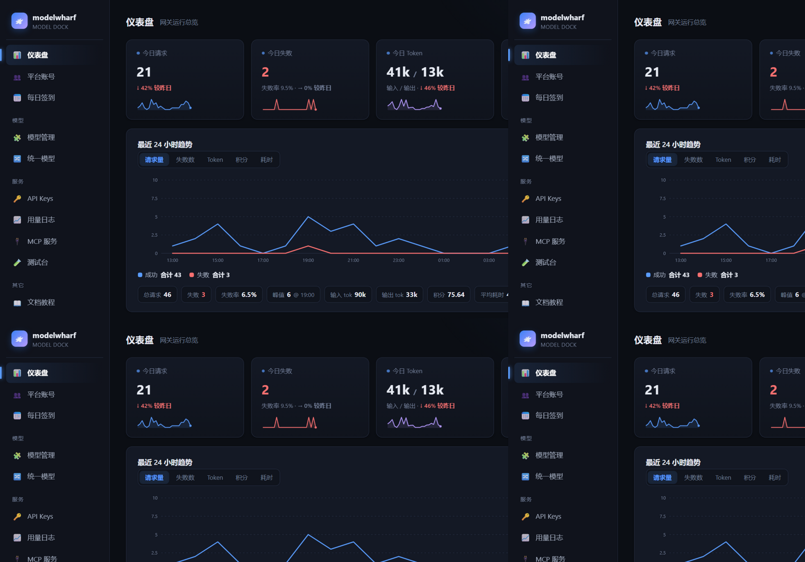
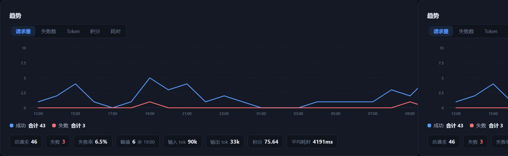

# modelwharf 模型码头

> 各家都在送 AI 积分，可每份积分都锁在工具里 —— 一个码头，全停进来。

多平台 AI 代理网关：把 **workbuddy(腾讯 CodeBuddy)、Trae(字节)、通义千问(chat.qwen.ai)、千问办公(QwenWork)、Qoder(阿里，国内/国际)、ChatGPT(OpenAI 网页版)、以及任意 OpenAI 兼容 API / 本地模型(Ollama)** 统一代理成标准 API，供各类 harness 工具（Claude Code、Cline、OpenClaw、Cursor 等）接入。自带网页管理面板。

```
harness 工具 ──►  本网关 (OpenAI /v1  +  Anthropic /v1/messages  +  MCP /mcp)
                        │
                        ├─ 逆向平台（账号池，多账号轮询）
                        │   ├─ workbuddy / CodeBuddy (腾讯) → copilot.tencent.com
                        │   ├─ trae (字节)                  → trae-api-cn.mchost.guru
                        │   ├─ qwen (chat.qwen.ai)          → 千问网页版
                        │   ├─ qwenwork (千问办公)          → gateway.qwenwork.cn
                        │   ├─ qoder · Qoder 国际版          → api1.qoder.sh
                        │   ├─ qodercn · Qoder 中国版        → gateway.qoder.com.cn
                        │   └─ chatgpt (OpenAI 网页版)       → chatgpt.com
                        ├─ 国际官方 API（key 即用）
                        │   ├─ OpenAI · Anthropic · Google Gemini · xAI(Grok) · Mistral
                        │   ├─ OpenRouter · Groq · Together · Perplexity · Cerebras · GitHub Models
                        ├─ 国内官方 API（key 即用）
                        │   ├─ 阿里百炼(Qwen) · 智谱GLM · 月之暗面Kimi · MiniMax · 火山方舟(豆包)
                        │   ├─ 腾讯混元 · 百川 · 阶跃星辰 · 硅基流动 · 书生 · 魔搭 ModelScope
                        └─ 本地 / 自定义
                            ├─ ollama（本地模型）
                            └─ openai-compat（任意 OpenAI 协议服务）
```

## 面板预览

> 截图为演示数据（mock 上游 + 虚构账号），界面与真实使用一致。

**仪表盘** —— 统计卡（24h 迷你趋势线 + 较昨日涨跌）、最近 24 小时趋势图、账号健康、今日模型 Top：



**用量趋势图** —— 请求量 / 失败数 / Token / 积分 / 耗时 五指标切换，折线/面积/柱状三种形态，窗口汇总条：



## 为什么有这个东西

最初用 WorkBuddy，就因为它送免费积分——代价是从此只能在 CodeBuddy 里用它。想把积分接到 Claude Code？去找个 workbuddy2api，单独逆向、单独跑一个服务。后来发现 Trae 也送积分，于是同样的事又做了一遍：抓 token、起服务、配工具。再到千问、Qoder……每认识一个新平台，就重来一次；上游一改版，几个逆向项目挨个修。

与其继续装，不如做一次。workbuddy / trae / qwen / qoder 的账号池（多账号轮询、签到、积分检查）+ 24 家官方 API（智谱、Kimi、硅基流动……key 即用），统一代理成 OpenAI / Anthropic / MCP 标准接口：**一个进程、一个 key、一个面板**，工具侧只改 base_url。新平台 = 一个插件文件，不再是一次重来。

## 快速开始

**最省事：丢给你的 AI 助手。** 复制这句话给 Claude Code / ZCode / Codex 等带命令执行能力的 agent：

> 读取 https://github.com/zouzhenglu/modelwharf 的 AGENTS.md，把这个网关在我电脑上装好、导入账号、并配进我正在用的 AI 工具。

它会按 [AGENTS.md](AGENTS.md) 全程代办：装依赖 → 常驻后台 → 扫描/导入账号 → 同步模型 → 生成 key → 写入工具配置 → 真实对话验证。

**自己动手**：要求 Node.js ≥ 22.19（Windows 可直接双击 `start.bat`，停止用 `stop.bat`）。

```bash
npm install
npm start                 # 默认 http://localhost:8317
```

- 管理面板：http://localhost:8317/admin （默认密码 `admin`，请立即在设置页修改）
- 要部署到服务器 / Docker（局域网多人用、手机也能连）→ [部署到服务器 / Docker](#部署到服务器--docker)

## 文档地图

| 你是谁 | 怎么用 | 看哪节 |
|---|---|---|
| **新人**，先看看这是什么 | 三分钟读懂痛点与解法 → 动手安装 | [为什么有这个东西](#为什么有这个东西) · [快速开始](#快速开始) |
| **不想动手**（推荐） | 把仓库地址丢给 AI 助手，安装/导账号/配工具全程代办 | [AGENTS.md](AGENTS.md) |
| 自己用（网页操作） | 面板添加账号 → 同步模型 → 生成 key → 测试台试聊 | [管理面板流程](#一管理面板流程自己用) |
| **技术人员**，接到 harness 工具（Claude Code / Cline / Cursor / Codex…） | 拿 base_url + key 填进工具；协议细节、环境变量、测试都在下文 | [接入教程](#二接入教程工具接进来) |
| **AI 助手**，网关已装好只差配工具 | 把 `$GW/docs/api.md` 喂给 AI，它读完端点/认证/模型清单后自动配好 | [给 AI 看的接入说明](#三给-ai-看的接入说明) |
| **已部署**，日常使用与维护 | 账号体检、签到、用量、升级、故障排查 | [管理面板流程](#一管理面板流程自己用) · [升级与排障](#升级与排障) |

---

## 一、管理面板流程（自己用）

1. **添加账号**（面板 → 平台账号 → 添加 / 或点「扫描本机登录」按钮导入本机已有登录态）
   - **手动扫描导入**：面板 → 平台账号 → 「扫描本机登录」，会扫描本机 Trae / TRAE SOLO / CodeBuddy(WorkBuddy) / Qoder CLI / 千问办公客户端 的已登录凭证并导入（按凭证指纹去重，可重复点击）。加密格式的凭证（新版 Trae / CodeBuddy `$wbEncrypted`）无法直接读出，面板会提示改为手动粘贴 token。
   - **手动添加**：面板 → 平台账号 → 「+ 添加账号」，选平台后按表单填凭证。各平台凭证来源：
     - Trae：本机 `%APPDATA%\Trae CN\User\globalStorage\storage.json` 的 `iCubeAuthInfo://icube.cloudide` 值（或抓 IDE 请求头 `Authorization` 里的 JWT）
     - WorkBuddy/CodeBuddy：`%LOCALAPPDATA%\CodeBuddyExtension\Data\Public\auth\*.info`，或抓包 `copilot.tencent.com` 请求头 `Authorization`
     - Qoder（国内版 / 国际版同一步骤）：客户端 设置 → Integrations 创建 PAT（`pt-` 开头，最稳）。两个版本是两套独立账号体系，账号分别挂在「Qoder 国际版」「Qoder 中国版」两个平台下；「扫描本机登录」会各扫各的。
     - 千问：chat.qwen.ai 登录后 Cookie 里的 `token`；也可直接填邮箱+密码由网关自动登录续期
     - 千问办公(QwenWork)：推荐「扫描本机登录」自动读取客户端登录态（`%APPDATA%\QwenWorkCN\auth-v2.dat`）；或添加账号弹窗点「网页授权登录」（设备码流程，无需客户端）；聊天需本机装有千问办公客户端（wasm 签名）
     - ChatGPT（OpenAI 网页版）：浏览器登录 chatgpt.com 后，F12 控制台执行 `(await (await fetch("/api/auth/session")).json()).accessToken` 复制 accessToken；填 Session Cookie（`__Secure-next-auth.session-token` 的值）可自动续期
2. **同步模型**（仪表盘 → 平台「同步模型」；之后可逐个模型 启用/停用/改名/设倍率/打标签）
3. **生成 API Key**（可限定该 key 能用的模型、限速）
4. **测试**（测试台：选模型 → 流式/非流式 → 实时输出 + token/积分耗时）

日常维护：仪表盘看各平台健康点；「账号检查」批量验证剩余积分；「自动签到」页配置每日定时签到（支持 UMID 设备指纹）。

## 二、接入教程（工具接进来）

网关同时暴露三种 API 协议 + MCP 网关，同一个 API key 通用：

> **网关地址（下文用 `$GW` 表示）**：本机部署默认 `http://localhost:8317`。**网关跑在其他机器上时（服务器 / Docker / 局域网），下文所有 `localhost` 都换成网关主机地址**，如 `http://192.168.1.10:8317` 或 `https://ai.example.com`。bash 示例统一用 `$GW` 变量，只改一处。

| 协议 | base_url | 适用工具 |
|---|---|---|
| OpenAI | `$GW/v1` | Cline、Cursor、OpenClaw、OpenAI SDK、绝大多数工具 |
| Anthropic | `$GW` | Claude Code、Anthropic SDK |
| Responses API | `$GW/v1` | Codex CLI、OpenAI Responses SDK |
| MCP | `$GW/mcp` | Claude Desktop、Cursor 等 MCP 客户端 |

key 在面板生成（形如 `wh-...`）。未配置任何 key 时网关为**开放模式**（不带认证头即可访问，仅限本机使用）。

### OpenAI 协议（Chat Completions）

```bash
GW=http://localhost:8317      # ← 换成你的网关地址

curl $GW/v1/chat/completions \
  -H "Content-Type: application/json" \
  -H "Authorization: Bearer wh-..." \
  -d '{"model": "glm-5.3", "messages": [{"role":"user","content":"你好"}], "stream": true}'
```

- 模型清单：`GET /v1/models`（key 限定了 allowed_models 时只返回该 key 可用的）
- 认证三选一：`Authorization: Bearer <key>`、`x-api-key: <key>`、`?key=<key>`
- 支持流式 SSE、非流式、`tools`/`tool_choice` 工具调用、图片输入（`image_url`，base64 或 URL）
- 采样参数透传给 OpenAI 兼容上游：`temperature` / `top_p` / `max_tokens` / `stop` / `seed` / `presence_penalty` / `frequency_penalty` / `logprobs` / `top_logprobs` / `n`（`n>1` 多选完整往返）
- 向量：`POST /v1/embeddings`（OpenAI 兼容上游透传，逆向平台返回 501）
- 兼容 `POST /v1/completions`（legacy 补全，含 `n>1` 多选；流式 `n>1` 报 400）

**Cline / Cursor / 其他 OpenAI 兼容工具**：Base URL 填 `$GW/v1`，API Key 填面板生成的 key，模型从 `/v1/models` 里选。

### Anthropic 协议（Claude Code）

```bash
export ANTHROPIC_BASE_URL=$GW      # 本机即 http://localhost:8317
export ANTHROPIC_AUTH_TOKEN=wh-...
claude
```

- 端点：`POST /v1/messages`（流式 SSE 事件与官方一致：`message_start` / `content_block_*` / `message_delta` / `message_stop`）
- 支持 system（字符串或 blocks）、多轮对话、图片（base64/URL）、`tools` 工具调用（`tool_use`/`tool_result`）、thinking 输出块
- `POST /v1/messages/count_tokens` 可用（本地估算，供 Claude Code 等做上下文预算）
- 请求体 `thinking: {type, budget_tokens}` 直接支持（预算→思考档位映射；模型名后缀优先）
- `GET /v1/models` 返回 Anthropic 形式模型列表

### Responses API（Codex CLI）

Codex 配置 `base_url = $GW/v1`（Wire API 选 Responses），或直接调 `POST /v1/responses`。支持流式事件、`reasoning` 汇总输出。

### MCP 网关

面板 → MCP 服务 添加上游 MCP server（stdio / http 均可），网关把所有已启用服务的 **tools / resources / prompts** 聚合暴露在 `$GW/mcp`（Streamable HTTP，JSON-RPC）：

- `tools/list` / `tools/call`、`prompts/list` / `prompts/get`：名称格式 `服务id__名称`
- `resources/list` / `resources/read`：资源 URI 带 `mcpres://服务id/…` 前缀（模板占位符原样保留）
- 认证与 `/v1` 相同：配置了 API key 后须带 key，未配置任何 key 时开放

客户端配置：

```json
{ "mcpServers": { "modelwharf": { "type": "http", "url": "http://localhost:8317/mcp" } } }
```

> 配置里的地址同样要与网关实际部署位置一致（本机 `localhost`，服务器填服务器地址）。

### ZCode 一键集成

```bash
node scripts/zcode-integrate.js            # 自动取网关里第一个可用 key（没有就创建）
node scripts/zcode-integrate.js --key wh-xxx --base $GW
```

写入前自动备份 `~/.zcode/v2/` 两个配置文件（合并写入、非覆盖），重启 ZCode 后选择提供商「modelwharf」。

### opencode 一键集成

```bash
node scripts/opencode-integrate.js            # 自动取网关里第一个可用 key（没有就创建）
node scripts/opencode-integrate.js --key wh-xxx --base $GW
```

备份（`.bak-` 后缀）并合并写入 `~/.config/opencode/opencode.json`（自定义 OpenAI 兼容 provider），不覆盖已有的其他 provider 和默认模型设置。跑完启动 `opencode`，Shift+Tab 切换到 modelwharf 的模型。

### 思考（reasoning）控制

所有模型统一用模型名后缀控制，无需改请求体：

| 模型名 | 效果 |
|---|---|
| `<model>-think` | 开启思考（medium） |
| `<model>-think-high` | 思考 + 高强度 |
| `<model>-xhigh` | 最高强度（qoder 档） |
| `<model>-nothink` | 关闭思考 |

后缀会按各平台协议自动映射（OpenAI 系 `reasoning_effort`、千问系 `enable_thinking`/`thinking_budget`、智谱/豆包 `thinking.type` 等）。

用 Anthropic 协议时也可以直接传 `thinking: {type: "enabled", budget_tokens: N}`（预算 ≥16384→high、≥4096→medium、其余 low；`{type:"disabled"}` 关思考）；模型名后缀与该字段同时存在时**后缀优先**。

## 三、给 AI 看的接入说明

让 AI 助手（Claude / ZCode / Cursor Agent 等）自己完成接入：

> 请读取 $GW/docs/api.md ，按照文档把我接入这个网关。

`/docs/api.md` 无需登录、**按访问地址实时生成**（用什么地址打开，文档里的示例就用什么地址），包含当前网关的端点、认证方式、实时模型清单（含免费/倍率标注）、请求示例和接入注意事项。AI 读完即可直接写出正确配置。

> 与 [AGENTS.md](AGENTS.md) 的分工：**AGENTS.md 管"装好并配好"**（安装、常驻、导账号、建 key、写工具配置，给有命令执行能力的 agent）；**`/docs/api.md` 管"已装好，接进来"**（只谈协议和模型，给负责写代码/配工具的 AI）。装机那句复制提示词见[快速开始](#快速开始)。

---

## 环境变量

> 从前身 `dsh-free-api` 升级：`DSH_*` 环境变量仍然生效（作别名）；数据库沿用旧 `data/dsh.db`，自动识别，无需迁移；已生成的 `sk-dsh-` 开头的 key 继续有效。新部署请直接用下表新变量名。


| 变量 | 默认 | 说明 |
|---|---|---|
| `WH_PORT` | `8317` | 监听端口 |
| `WH_HOST` | `0.0.0.0` | 监听地址（仅本机用可设 `127.0.0.1`） |
| `WH_ADMIN_PASSWORD` | `admin` | 面板登录密码 |
| `WH_API_KEYS` | 空 | 逗号分隔的静态 key；不设且面板未建 key 时为开放模式 |
| `WH_DATA_DIR` | `./data` | SQLite 数据目录（凭证存这里，勿外传） |
| `WH_LOG_DIR` | `./logs` | 日志目录 |
| `WH_SESSION_SECRET` | 随机 | 面板会话签名密钥（重启后登录态失效，长期使用建议固定） |
| `WH_REQUEST_TIMEOUT_MS` | `300000` | 上游请求超时 |
| `WH_LOG_RETENTION_DAYS` | `30` | 用量日志保留天数 |

## 功能对照需求

| 需求 | 实现 |
|---|---|
| 保留平台倍率/免费信息 | models 表 `multiplier`/`is_free` 字段；插件同步时带入；Qoder 错峰倍率、workbuddy hy3 免费、千问全免费等 |
| 多账号登录与切换 | accounts 表按平台任意多账号；优先级+轮询+并发上限；401/403 自动标记失效，5xx 指数退避冷却 |
| 网页后端管理 | `/admin` 单页面板：账号/模型/Key/用量/MCP/测试台/签到/设置 |
| 网页测试 | 测试台：选模型 → 流式/非流式 → 实时输出+token+积分耗时 |
| 剩余积分 | 账号「检查」按钮调用各平台积分接口（trae 签到状态、qoder 官方 quota、codebuddy billing、qwen 档案、qwenwork 三池积分：每日免费/订阅/长期） |
| 用量/禁用启用/搜索筛选 | usage 全量日志（时间/平台/账号/模型/token/积分/耗时/状态），各列表页均带搜索+筛选 |
| 扩展接口 | provider 插件协议（见 `src/core/registry.js` 注释）；新增平台=一个文件；已内置 24 个官方厂商 + openai-compat/ollama 通用插件 |
| 账号-模型绑定管理 | 模型层面启停 + API key 级 `allowed_models` 白名单 |
| 本地集成 | 「导入本机登录」扫描 Trae/CodeBuddy/Qoder（国内版+国际版分别扫）/千问办公客户端 的本地凭证文件 |
| 负载均衡/故障转移 | 虚拟（统一）模型多目标：顺序故障转移 / 加权随机 / 最少连接 三种策略，失败自动切换；单平台内账号按优先级+轮询 |
| 主流协议 | OpenAI `/v1/chat/completions`、`/v1/completions`、`/v1/models`、`/v1/embeddings`；Responses `/v1/responses`；Anthropic `/v1/messages`（含 thinking/tool_use/count_tokens）；MCP 网关（tools/resources/prompts） |

## 已实现 / 能力边界（如实清单）

**已实现**：

- OpenAI：`chat/completions`（流式/非流式/tools/图片/多选 `n`）、`completions`（含多选 `n`）、`models`、`embeddings`；透传 `temperature` / `top_p` / `max_tokens`(含 `max_completion_tokens`) / `tool_choice` / `stop` / `seed` / `presence_penalty` / `frequency_penalty` / `logprobs` / `top_logprobs` / `n`
- Anthropic：`messages` 流式事件、system、多轮、图片、`tools`（tool_use/tool_result 往返）、thinking 输出块、`count_tokens`（估算值）、`thinking: {budget_tokens}`（按预算映射思考档位，`-think` 后缀优先）
- Responses：`/v1/responses` 流式事件、reasoning 汇总、`-think` 后缀路由
- MCP：上游 stdio/http 服务注册、`tools/*` / `resources/*` / `prompts/*` 聚合、tool_filter、端点鉴权（与 `/v1` 网关同语义）
- 账号池：多账号轮询/优先级/并发上限/失效标记/退避冷却；虚拟模型多目标故障转移 + 负载均衡策略（顺序/加权随机/最少连接）

**注意**（能力边界，如实说明）：

- `embeddings` 与采样参数透传依赖 OpenAI 兼容上游（openai-compat / 官方厂商 / ollama）；逆向平台（trae/qoder/qwen/workbuddy/qwenwork…）无 embeddings 时返回 501，收到不支持的采样参数由其插件白名单过滤
- `count_tokens` 为本地估算（无上游 tokenizer，误差 ±20% 左右），Claude Code 等客户端的上下文预算足够用
- MCP `resources/read` 需用 `resources/list` 返回的 `mcpres://` 前缀 URI；`resources/subscribe`（变更通知）不支持
- legacy `/v1/completions` 的流式模式不支持 `n>1`（明确报 400，请改用 `/v1/chat/completions`）；非流式完整支持

## 已知限制（如实说明）

- **逆向平台随时可能变化**：端点/加密/风控来自开源社区逆向成果（见下），上游改版后需要跟着更新对应插件。Trae 本地存储若为加密格式，需手动粘贴 token；WorkBuddy 新版客户端的 `$wbEncrypted` 信封同理。
- **Qoder COSY 签名**未完整实现（签名+AES+RSA 链路复杂），当前用 PAT 模式（官方支持创建，最稳）。
- **千问办公（qwenwork）**聊天请求体必须由官方客户端自带的 `qoder_auth_wasm_bg.wasm` 签名（本机需安装千问办公客户端；运行时从安装目录读取，不随本仓库分发）。积分与账号检查无需客户端。上游 1.2.x 已验证，客户端大版本更新后可能需要适配。
- **ChatGPT 网页版**：① 免费/Plus 账号的部分模型有 arkose/PoW 人机校验，本插件未实现，命中时上游 403 原文透传（换模型或账号再试）；② 上游不返回 token 用量，记账按 0 计；③ 不支持函数调用与图片输入；④ accessToken 约 2 周过期，不填 Session Cookie 时需重新粘贴。
- 单机 SQLite，无分布式；面向个人/小团队本地使用。

## 参考的开源项目

本项目为原创代码，但上游平台协议细节参考了这些项目的公开逆向成果：
- Trae: `JeffHu0912/trae2api`、`Trae2api-cn`、`A-23187/trae-api`
- WorkBuddy/CodeBuddy: `linguo2625469/workbuddy2api-panel`、`xiaofan6ya/workbuddy2api`
- Qoder: `shuishuipingan/qoder2api-hub`、`fengyinxia/qoder2api`、`Zhengyuuuui/qoder2api`
- QwenWork (千问办公): `wearetheone777/dumate2api`、`wpy030414/xrl-router-plugin-qwenwork`；wasm 签名封装基于 `wicm84266964/Buddy2api`（MIT，`src/providers/_qwenwork_wasm_helper.mjs`）
- Qwen: `LLM-Red-Team/qwen-free-api` 系
- ChatGPT: `ChatGPT-to-API` / `Pandora` 一系的 backend-api 公开逆向成果

⚠️ 使用逆向接口请自行评估各平台服务条款与账号风险。

## Git 管理

- `main` 稳定发布分支，每个发布打 tag（见 [CHANGELOG.md](CHANGELOG.md)）
- `dev` 开发分支，功能验证后合入 main 并打 tag
- `data/`（数据库）、`logs/`、`.env` 均已 gitignore，凭证不会入库
- 许可证：MIT（见 [LICENSE](LICENSE)；第三方组件声明见 [NOTICE](NOTICE)）

## 测试

```bash
npm install
npm test           # 64 个端到端用例（自带隔离服务 + mock 上游，不依赖真实账号）
```

## 部署到服务器 / Docker

服务器部署后，客户端工具里的网关地址换成 `http://<服务器地址>:8317`（即上文 `$GW`）。

```bash
# 部署（数据与日志挂卷持久化）
docker run -d -p 8317:8317 -v wharf-data:/app/data -v wharf-logs:/app/logs \
  ghcr.io/zouzhenglu/modelwharf:latest
```

> 镜像由 CI 自动构建推 GHCR：`main` → `:main`，tag → `:x.y.z` / `:x.y` / `:latest`。首次推送后 GHCR 包默认 private，需在包设置改为 public 才能匿名拉取。
> 千问办公（qwenwork）依赖本机客户端的 wasm 签名，容器内无法使用该 provider，其余全部可用。
> **对外暴露前**：必须改默认面板密码 + 设置 `WH_API_KEYS`，并确认 `WH_HOST`/防火墙规则（见[安全说明](#安全说明)）。

## 升级与排障

```bash
# 升级（源码部署）：拉代码装依赖后重启服务（systemctl / 计划任务 / 重开 start.bat）
git pull && npm install && npm test
# 升级（Docker）：重新 docker run 新镜像即可，挂卷里的数据不丢
```

| 现象 | 处理 |
|---|---|
| 启动即段错误 / native module 报错 | Node < 22.19，见[快速开始](#快速开始)升级 |
| `EADDRINUSE` | 端口占用，设 `WH_PORT` 换端口 |
| 上游 401/403，账号变 `invalid` | 凭证过期或风控：重新「扫描本机登录」导入；trae/workbuddy 可补 `refreshToken` 自动续期；qwen 用邮箱+密码模式 |
| 扫描导入 0 条 | 本机没装客户端或没登录；加密凭证（`$wbEncrypted`）扫不出，手动粘贴 token |
| qwenwork 聊天报错 | 需本机装千问办公客户端（wasm 签名）；积分/账号检查不受影响 |
| 上游 5xx / 连不上 | 逆向平台随时可能改版（[已知限制](#已知限制如实说明)），检查有无新版本，或暂用官方 API 平台 |

更详细的 agent 排障路径见 [AGENTS.md](AGENTS.md) §9；账号/用量详情在面板「用量」页。

## 自动化（GitHub Actions）

| 工作流 | 触发 | 做什么 |
|---|---|---|
| `ci.yml` | push `main`/`dev`、任何 PR | Linux + Windows × Node 22/24 四路跑全部端到端用例 |
| `release.yml` | push tag `v*` | 测试通过后自动创建 GitHub Release，附源码 zip，发布说明取自 CHANGELOG 对应小节 |
| `docker.yml` | push `main`、push tag `v*` | 自动构建镜像推 GHCR（见上节） |

```bash
# 发版：打 tag 即自动出 Release + Docker 镜像
git tag v0.11.0 && git push origin v0.11.0
```

## 安全说明

- 所有凭证只存本机 SQLite（`data/`，已 gitignore），不外发
- 面板密码默认 `admin`，仅限本机使用；对外暴露请务必设置 `WH_ADMIN_PASSWORD` 与 `WH_API_KEYS`（默认网关不设 key 时对局域网开放）
- MCP 网关端点（`/mcp`）鉴权与 `/v1` 相同：配置了 API key 后必须携带 key，未配置任何 key 时为开放模式
- 如发现安全问题请勿公开提 issue，请联系仓库所有者
