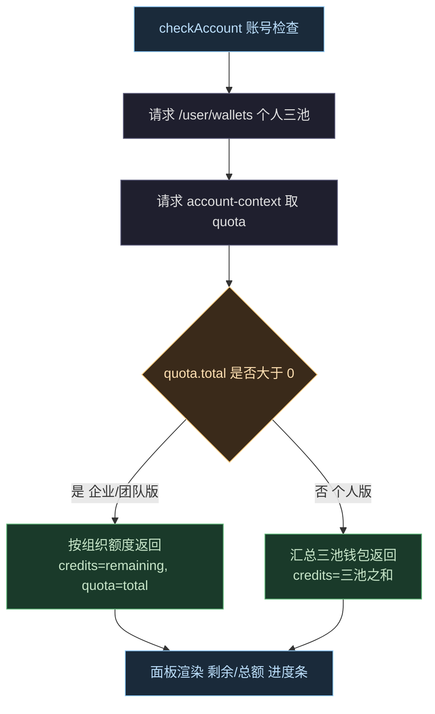

# 千问办公（QwenWork）企业版额度识别与非系统盘安装修复

## 背景

接入「千问办公」企业/团队账号后，面板出现两个现象：

1. 账号已成功导入、聊天可用，但**账号检查始终显示积分 0**。
2. 客户端未安装在 C 盘时，聊天直接报错 `未找到 qoder_auth_wasm_bg.wasm`。

本文记录这两个问题的根因与修复逻辑，便于后续排障和上游协议变更时对照。

## 问题一：企业版组织额度显示为 0

### 两类额度体系

千问办公的额度分两套互斥的体系，分别由不同接口返回：

| 账号类型 | 额度位置 | 接口 | 字段 |
|---|---|---|---|
| 个人版 | 个人钱包（每日 / 订阅 / 长期三池） | `GET https://qwenwork.cn/user/wallets` | `daily_credits` / `monthly_credits` / `longterm_credits` 的 `total_balance` |
| 企业/团队版 | 组织配额 | `GET https://gateway.qwenwork.cn/api/v1/adapter/user/account-context?include=user,plan,quota` | `quota.total` / `quota.used` / `quota.remaining` |

企业账号（`is_biz=true`、组织角色 `team-member`、套餐 `qwen-office-enterprise`）的额度由组织统一发放，**只体现在 `account-context` 的 `quota` 上，个人钱包三个池均为空**。

### 根因

修复前 `checkAccount()` 只调用 `/user/wallets` 并汇总三个个人钱包，完全没有读取 `account-context` 的 `quota` 字段，因此企业账号恒显示 0。

### 修复后的判定逻辑

要点：

- **数据驱动、向后兼容**：以 `quota.total > 0` 作为企业额度的判定条件。个人账号该字段为 0 或缺失，自动落回原三池逻辑，行为不变。
- **字段语义对齐前端**：面板进度条约定 `extra.credits` = 剩余、`extra.quota` = 总额。企业分支据此填充，前端无需改动即可显示「剩余 / 总额 + 进度条」。
- **保留三池字段**：企业分支仍返回 `dailyCredits/monthlyCredits/longtermCredits`（值为 0），不破坏其它消费方。
- **签到回写保护**：`checkin()` 余额回查同样只读个人钱包。对企业账号（`planId` 含 enterprise/team/biz，或已存在 `orgQuota`）保留 `checkAccount` 已同步的组织额度，避免签到后被空钱包清零。

## 问题二：非系统盘安装导致 wasm 找不到

### 根因

千问办公自客户端 1.1.0 起，聊天请求体必须由客户端内置的官方 wasm（`qoder_auth_wasm_bg.wasm`）做 `Encode=1` 密封签名。该文件是客户端的二进制资产，网关运行时从本机安装目录解析，**不随仓库分发**。

修复前 `_qwenwork_bridge.js` 的 `candidateRoots()` 把扫描盘符**写死为 C/D/E**。当客户端安装在其它盘符（如 `F:\Program Files\QwenWorkCN`）时，`resolveWasm()` 返回 null，聊天直接抛出 500。

### 修复

新增 `availableDrives()`：

- Windows 下枚举 C–Z 中**实际存在的盘符**（`fs.accessSync` 探测），替代写死的三个盘；
- POSIX 退化为仅根目录；
- 结果进程内缓存，不引入额外重复 IO。

版本目录仍由原有 `versionRank()` 自动选取最新版本，因此**客户端升级后无需任何手工配置**。原有的 `QWENWORK_WASM` / `CB_QWENWORK_WASM` 显式环境变量优先级保持不变，可继续用于特殊安装布局。

## 验证

- 企业账号检查返回 `组织额度 remaining/total（已用 used）`，面板进度条正确。
- 不设任何环境变量，网关注解到非系统盘的 wasm，模型列表同步与聊天均正常。
- 个人账号走原三池分支，回归无变化；单元测试与端到端测试通过。

## 涉及文件

| 文件 | 改动 |
|---|---|
| `src/providers/qwenwork.js` | `checkAccount` 增加组织 quota 识别；`checkin` 余额回写保护 |
| `src/providers/_qwenwork_bridge.js` | `availableDrives()` 动态盘符探测，替换写死的 C/D/E |
